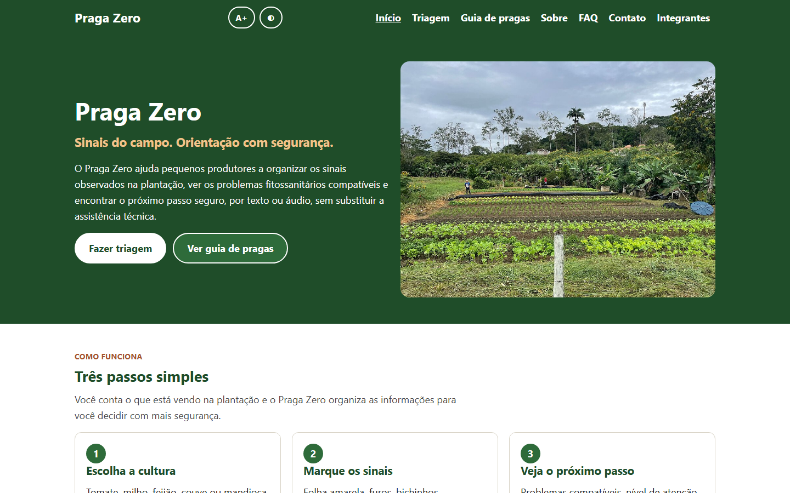

# Praga Zero

**Sinais do campo. Orientação com segurança.**

## Descrição

O Praga Zero ajuda pequenos produtores a organizar os sinais observados na plantação, ver os problemas fitossanitários compatíveis e encontrar o próximo passo seguro, por texto ou áudio, sem substituir a assistência técnica.

Este é o site do projeto, feito para a disciplina Front-End Design Engineering da Global Solution 2026 da FIAP. Ele tem uma triagem interativa e um guia de pragas, e usa as mesmas regras e dados do nosso chatbot e do console do técnico (Python e Java). O site nunca indica agrotóxico, produto, marca ou dose (Lei 14.785/2023).

## Imagens

Página inicial no desktop (1440 px):

Página inicial no celular (390 px) e triagem no tablet (768 px):

## Tecnologias