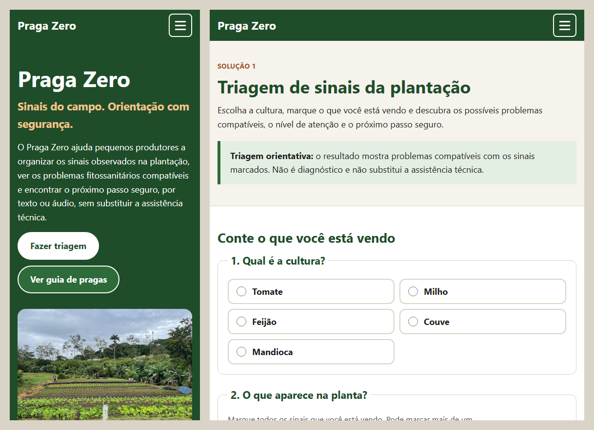

# Praga Zero

**Sinais do campo. Orientação com segurança.**

## Descrição

O Praga Zero ajuda pequenos produtores a organizar os sinais observados na plantação, ver os problemas fitossanitários compatíveis e encontrar o próximo passo seguro, por texto ou áudio, sem substituir a assistência técnica.

Este é o site do projeto, feito para a disciplina Front-End Design Engineering da Global Solution 2026 da FIAP. Ele tem uma triagem interativa e um guia de pragas, e usa as mesmas regras e dados do nosso chatbot e do console do técnico (Python e Java). O site nunca indica agrotóxico, produto, marca ou dose (Lei 14.785/2023).

## Imagens

Página inicial no desktop (1440 px):


Página inicial no celular (390 px) e triagem no tablet (768 px):



## Tecnologias

- HTML5
- CSS3
- JavaScript
- Git e GitHub

Sem frameworks, bibliotecas ou templates.

## Páginas

- `index.html`: página inicial
- `pagina-solucao-1.html`: triagem (cultura + sinais → problemas compatíveis, nível de atenção e próximo passo)
- `pagina-solucao-2.html`: guia de pragas com filtro por cultura
- `sobre.html`: o problema, a proposta, as regras e os ODS
- `faq.html`: perguntas frequentes em acordeão
- `contato.html`: formulário com validação
- `integrantes.html`: a equipe

## Estrutura de pastas

```
praga-zero/
├── index.html
├── integrantes.html
├── sobre.html
├── faq.html
├── contato.html
├── pagina-solucao-1.html
├── pagina-solucao-2.html
├── README.md
├── css/
│   └── style.css
├── js/
│   ├── script.js      (menu e funções comuns, usado em todas as páginas)
│   ├── dados.js       (culturas, sintomas e pragas)
│   ├── regras.js      (regras de negócio)
│   ├── triagem.js
│   ├── guia.js
│   ├── faq.js
│   └── contato.js
└── assets/
    ├── images/
    └── icons/
```

## Como executar

Abra o arquivo `index.html` no navegador.

## Autores

| Nome | RM | Turma | GitHub | LinkedIn |
|---|---|---|---|---|
| Miguel Freire Trevisan | 574414 | 1TDSPB | [GitHub](https://github.com/miguelfreiretrevisan) | [LinkedIn](https://www.linkedin.com/in/miguel-freire-trevisan-b22800431/) |
| Carlos Eduardo Schmidt Cohen | 574448 | 1TDSPB | [GitHub](https://github.com/schmidtcarlos15-arch) | [LinkedIn](https://www.linkedin.com/in/carlos-schmidt-b08b95365/) |
| Everson Domingos Junior | 575056 | 1TDSPB | [GitHub](https://github.com/Everson-Domingos-Junior) | [LinkedIn](https://www.linkedin.com/in/everson-domingos-junior/) |
| Enzo Barbosa Frasca | 574943 | 1TDSPB | [GitHub](https://github.com/enzofrasca) | [LinkedIn](https://www.linkedin.com/in/enzo-frasca-768364275/) |
| João Gabriel da Silva Leite | 575724 | 1TDSPB | [GitHub](https://github.com/JGTI09) | [LinkedIn](https://www.linkedin.com/in/joao-gabriel-4a6137442/) |

## Repositório

https://github.com/enzofrasca/praga-zero

## Contato

Pelo formulário da página [contato.html](contato.html).

## Créditos das imagens

- Foto da página inicial: "Plantação de hortaliças de agricultores familiares", de EuLuaFonseca, [CC BY-SA 4.0](https://creativecommons.org/licenses/by-sa/4.0/), via [Wikimedia Commons](https://commons.wikimedia.org/wiki/File:Planta%C3%A7%C3%A3o_de_hortali%C3%A7as_de_agricultores_familiares.jpg)
- Ícones: [Lucide](https://lucide.dev) (licença ISC)

## Uso de IA

Usamos IA generativa só como apoio para pesquisa, revisão de texto e explicação de erros. Todo o código foi revisado pela equipe.
